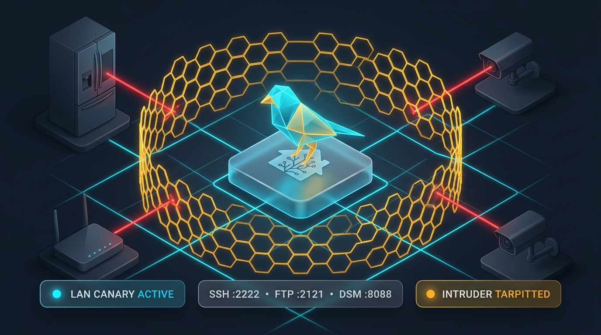

# 🕸️ Home Assistant LAN Canary Honeypot & Active TCP Tarpit



A zero-dependency Home Assistant custom component and package that turns your Home Assistant box into an **internal LAN Canary Honeypot + Active TCP Tarpit** (with built-in webhook support for a secondary **Synology NAS OpenCanary** container).

---

## Despre acest fork (RO)

Fork din [robainbinder/ha-lan-canary-tarpit](https://github.com/robainbinder/ha-lan-canary-tarpit),
adaptat pentru o retea de acasa cu Home Assistant OS. Ce e diferit fata de original:

1. **Anti-spam pe notificari** — originalul trimite o notificare critica la *fiecare* pachet,
   deci un scan de 6 porturi = 6 alerte, iar un `nmap` cu reincercari zeci. Aici fiecare IP
   sursa primeste o singura notificare per fereastra `cooldown` (implicit 300 s); toate sondele
   sunt in continuare numarate si scrise in `input_text`.
2. **Lista alba de IP-uri** (`ignore_ips`) — pentru scanerele proprii (monitorizare, laptopul tau).
   Conexiunea lor e inchisa imediat, fara alerta si fara capcana.
3. **Eveniment HA in loc de truc cu input_boolean** — componenta emite `lan_canary_hit` cu
   `ip`, `host`, `port`, `service`, `payload`, `trapped`, `notify`. Originalul stingea si
   reaprindea `input_boolean` ca sa re-declanseze automatizarea.
4. **Configurabil din YAML** (`cooldown`, `ignore_ips`, `ports`, `tarpit_minutes`, `max_sockets`),
   reverse-DNS cu timeout, inchidere curata a serverelor la oprirea HA, texte si loguri in romana.

Capcana in sine (porturile momeala, bannerele false Synology, picurarea pe protocol) e cea din
original — acolo e ideea buna.

### Instalare

1. HACS / Marketplace -> repo custom `blitzu/ha-lan-canary-tarpit`, categoria *Integration* -> Download.
2. In `configuration.yaml`:

   ```yaml
   lan_canary:
     cooldown: 300
     ignore_ips: []
   ```
3. Helperii (`input_boolean.canary_alerta_intruziune`, `input_text.canary_ultimul_eveniment`,
   `input_number.canary_numar_hituri`) + automatizarile: fie din interfata, fie cu pachetul
   din `packages/lan_canary_tarpit.yaml`.
4. Restart HA, apoi test din alt calculator din LAN: `nc -v <IP_HA> 2222`.

---

## 💡 Why Build This? (The "Flat Mesh Wi-Fi" Blind Spot)

Most home networks use consumer mesh routers (AmpliFi, Eero, Google Nest, Orbi) where every laptop, phone, smart fridge, dishwasher, printer, and IoT device shares a single flat `/24` subnet.

* **What your router's built-in firewall blocks (`North-South`):** Unsolicited traffic coming in from the public Internet (WAN → LAN).
* **What your router's firewall *never* sees (`East-West`):** Device-to-device traffic *already inside* your Wi-Fi. If a smart appliance gets compromised via a vendor cloud breach, bad firmware update, or a guest laptop brings malware onto your Wi-Fi, its lateral port scans across `192.168.x.0/24` switch directly on the local LAN and never cross the router's WAN firewall.

Because no legitimate device on your network ever has a reason to connect to decoy NAS ports on your Home Assistant IP, **a single packet to any of these ports is a 100% high-signal, zero-false-positive indicator of lateral scanning inside your home.**

---

## 🕸️ How the Active TCP Tarpit Works

Instead of simply logging the probe and closing the socket (which lets an automated scanner immediately move on to scan the rest of your subnet), this integration:

1. **Fires an Immediate Critical Push Alert (<1.5s):**
   * Captures the first packet/login payload sent by the scanner.
   * Resolves the offending LAN device's reverse-DNS hostname (e.g. `192.168.1.107 (smart-dishwasher)`).
   * Sends an actionable **iOS/Android Critical Push Alert** to your phone *before* entering the tarpit loop.
2. **Traps the Scanner in a Protocol-Specific Slow-Drip Tarpit (`10s Drip` for up to `15 Minutes` per Thread):**

| Decoy Port | Emulated Service | Protocol Tarpit Technique |
| :---: | :--- | :--- |
| **`:2121`** | **Synology FTP** | **RFC 959 Multi-Line `220-` Continuation Trap:** Sends `220-DiskStation FTP initializing...` (with a hyphen) and drips `220-DiskStation RAID check X%...` every 10s without ever sending the final `220 ` space. |
| **`:2222`** | **Synology SSH** | **RFC 4253 §4.2 Pre-Banner Tarpit (`Endlessh` style):** The SSH spec allows unlimited lines before `SSH-2.0-`. Drips `Synology-DSM-KeyCheck-X: wait` every 10s so SSH scanners/brute-forcers hang waiting for the handshake. |
| **`:2323`** | **Telnet Login** | Spoofs `DiskStation-NAS login: ` and drips 1 null keepalive byte every 10s to freeze Mirai-style Telnet bots. |
| **`:3306`** | **MariaDB / MySQL** | Spoofs a `5.5.68-MariaDB-Synology` greeting header and slow-drips keepalive bytes. |
| **`:5900`** | **VNC Desktop** | Spoofs `RFB 003.008` and holds the RFB handshake open in a 10s slow drip. |
| **`:8088`** | **Synology DSM Web** | **Reverse Slowloris HTTP Header Tarpit:** Sends `HTTP/1.1 200 OK` and drips `X-Synology-Auth-Wait-X: ...` headers every 10s without ever sending the closing `\r\n\r\n`. |

* **Memory-Safe Concurrency Cap:** Capped at `64` concurrent tarpitted sockets so an aggressive scanner can never exhaust Home Assistant's RAM or event loop.
* **One-Tap Lock-Screen Release:** Long-pressing the iPhone push alert (`✅ Acknowledge & Release Tarpit`) or toggling off `input_boolean.canary_intrusion_alert` calls `lan_canary.reset_canary`, severing all trapped sockets and re-arming the tripwire.

---

## 🚀 2-Minute Installation

1. Copy `custom_components/lan_canary` into your Home Assistant `/config/custom_components/lan_canary/` directory.
2. Copy `packages/lan_canary_tarpit.yaml` into `/config/packages/lan_canary_tarpit.yaml`.
3. Add `lan_canary:` to `/config/configuration.yaml`:
   ```yaml
   homeassistant:
     packages: !include_dir_named packages

   lan_canary:
   ```
4. Restart Home Assistant.
5. **Test it from any computer on your LAN:**
   ```bash
   nc -v <YOUR_HA_IP> 2222
   ```
   You'll see the fake Synology banner followed by a 10-second slow drip (`Synology-DSM-KeyCheck-1: wait...`) while your phone immediately receives a Critical Push alert identifying your computer's IP and hostname.

---

## 🗄️ Optional: Pairing with Synology Container Manager (`OpenCanary`)

If you also run a Synology NAS (e.g., for nightly Home Assistant SMB backups), you can run full [Thinkst OpenCanary](https://github.com/thinkst/opencanary) in Synology Container Manager on a dedicated `macvlan` IP and point its webhook output to:

```text
http://<YOUR_HA_IP>:8123/api/webhook/opencanary_intrusion_alert
```

Both the built-in 6-port Active TCP Tarpit and external OpenCanary webhook alerts feed into the same Home Assistant sensor (`sensor.canary_tripwire_status`) and mobile push notification pipeline.
